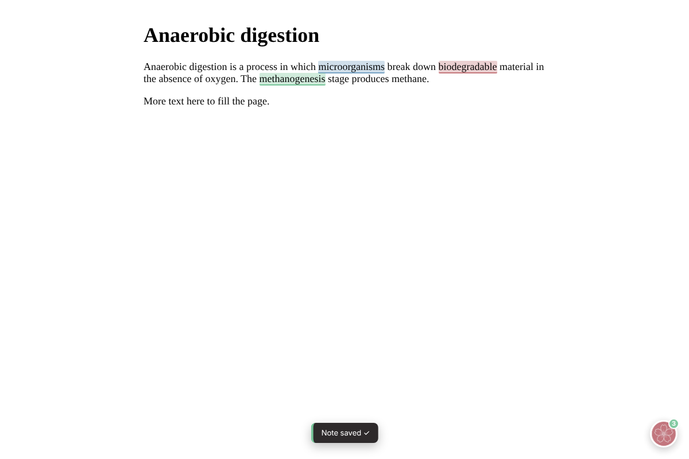

# [APP_NAME] — Sticky notes for anything you read

Select any word or sentence on any web page or PDF → click the flower button → write a sticky note (text, photos, tags, folder, colour, AI meaning) → it's highlighted on the page next time, and all notes live on your dashboard (laptop and phone).



## What's in this folder

| Folder | What it is |
|---|---|
| `extension/` | Browser extension (Chrome, Edge, Brave, Opera, Firefox; Safari possible) |
| `web/` | Website / dashboard (installable as an app on phone and computer) |
| `supabase/migrations/` | Database setup — run `0001_init.sql`, then `0002_stages_2_to_8.sql` |
| `design/` | Your logo |
| `screenshots/` | How it looks |
| `SPEC.md` | The full plan, now including design decisions |
| `STORE_LISTING.md` | Text to paste into the Chrome / Edge / Firefox stores |

## ✅ What's built (Stages 1–8)

**Extension**
- Select text → flower button → sticky note. Title = selected text, in your chosen cute font.
- Rich text (bold, italic, lists), **photos** (button, paste, or drag in), **tags** (with suggestions), **folder** (or create one), **4 colours** (pink, green, blue, yellow).
- **✨ AI meaning**: appears in grey inside the note; press **Tab** to accept (like Copilot), or just type.
- **Highlights come back** when you revisit a page. Click a highlight to see the note. Works on pages that load content late. Notes whose text changed are listed under "Couldn't find on page".
- Floating flower button (bottom-right) shows the number of notes on the page. Click it for the list (click one to jump to it). It can be hidden per site.
- **PDFs**: built-in PDF viewer (PDF.js). When you open a PDF in Chrome/Edge, a banner offers "Open in [APP_NAME]", or turn on "Always". You can also open PDFs from your computer through the extension icon. Notes come back on the same PDF, matched by its fingerprint even if it's a different copy or link.
- Offline: notes saved without internet are kept and uploaded later automatically.
- Settings in the popup: AI on/off, explanation language (English, Bangla…), default colour, **title font** and **text font**.
- Keyboard shortcut **Ctrl+Shift+Y** (Mac ⌘+Shift+Y).

**Website**
- Dashboard of sticky-note cards. Search, filters (web/PDF, date), folders (create, rename, delete), tags, websites.
- Open a note to edit (rich text, photos, tags, folder, colour, ✨ Suggest meaning), delete it, or **share it with a public link**.
- Share a whole **folder or tag** with a public link.
- **Export** the current view to **Word (.docx)** or **PDF** (print page → "Save as PDF", works on phones).
- **PDF library**: upload PDFs, read and annotate them in the browser (also on phone). Notes made with the extension on the same PDF appear too.
- **Settings**: name, AI, language, colour, **fonts** (Lobster, Pacifico, Grand Hotel, Fredericka the Great, Inter for titles; Inter or Times New Roman for text), delete account.
- Installable app (PWA) with offline viewing of recently opened pages. Privacy policy and Terms pages (templates, fill in `[DATE]` and `[YOUR EMAIL]`).

**Design:** your cherry-blossom logo everywhere; pink `#C5777C` main colour with green `#77C599` and blue `#77A3C5`.

---

## Setup — step by step (all free)

### You need
- **Node.js** 20 or newer (https://nodejs.org → LTS)
- A free **Supabase** account (https://supabase.com)

### 1. Database
1. Supabase → **New project** (region: Singapore or Mumbai).
2. **SQL Editor → New query** → paste all of `supabase/migrations/0001_init.sql` → **Run**.
3. New query again → paste all of `supabase/migrations/0002_stages_2_to_8.sql` → **Run**.
4. **Project Settings → API**: keep the **Project URL** and **anon / public key** handy.
5. For easy testing: **Authentication → Sign In / Providers → Email** → turn off "Confirm email". Turn it back on before publishing.

> Already ran 0001 for Stage 1? Just run 0002 now. Your notes are kept.

### 2. Website
```bash
cd web
npm install
```
Copy `web/.env.example` to `web/.env.local` and fill in the URL and key. Then:
```bash
npm run dev
```
Open http://localhost:3000 and sign up.

### 3. AI meanings (optional but recommended)
1. Get a free key at https://aistudio.google.com/apikey
2. Put it in `web/.env.local` as `GEMINI_API_KEY=...`, then restart `npm run dev`.
3. Without a key, single English words still get a dictionary meaning.
4. If Google renames its models and suggestions stop, set `GEMINI_MODEL=` to a current "flash" model name from Google's docs.

### 4. Extension
```bash
cd extension
npm install
```
Copy `extension/.env.example` to `extension/.env` and fill in the URL and key. `WXT_DASHBOARD_URL` stays `http://localhost:3000` for now. Then:
```bash
npm run build
```
- **Chrome / Edge / Brave:** `chrome://extensions` (or `edge://extensions`) → **Developer mode** on → **Load unpacked** → choose `extension/.output/chrome-mv3`. If you've loaded it before, click the reload ↻ icon instead.
- **Firefox:** `npm run build:firefox` → `about:debugging` → **This Firefox** → **Load Temporary Add-on** → `extension/.output/firefox-mv2/manifest.json`.
- To open PDFs **from your computer** directly: `chrome://extensions` → the extension → **Details** → turn on **Allow access to file URLs**.

Click the extension icon and log in with the same email and password. Reload any open tabs.

### 5. Put it online (free)
1. Push this folder to GitHub (the `.gitignore` already keeps keys out).
2. https://vercel.com → **New Project** → import → **Root Directory = `web`** → add the environment variables from `.env.local` → **Deploy**.
3. Supabase → **Authentication → URL Configuration**: set **Site URL** to your Vercel address and add `https://YOUR-SITE.vercel.app/auth/callback` to Redirect URLs.
4. In `extension/.env` set `WXT_DASHBOARD_URL=https://YOUR-SITE.vercel.app`, then `npm run build` again.
5. On your phone: open the site → browser menu → **Add to Home screen**.

### Google login (optional)
Supabase → **Authentication → Sign In / Providers → Google** and follow its guide. Add your `/auth/callback` addresses (local and Vercel) to Redirect URLs.

---

## Publishing the extension
1. Choose the app name. Ask Cursor: *"Replace [APP_NAME] with MyName in all files"*. Also change the Firefox id in `extension/wxt.config.ts`.
2. Fill in `[DATE]` and `[YOUR EMAIL]` in `web/app/privacy/page.tsx` and `web/app/terms/page.tsx`.
3. Build the store zips:
   - `npm run zip` (Chrome and Edge)
   - `npm run zip:firefox` (Firefox)
   
   They land in `extension/.output/`.
4. Upload them:
   - **Chrome Web Store:** https://chrome.google.com/webstore/devconsole ($5 one-time)
   - **Edge Add-ons:** https://partner.microsoft.com/dashboard/microsoftedge (free)
   - **Firefox Add-ons:** https://addons.mozilla.org/developers (free)
   
   Copy the texts from `STORE_LISTING.md`.
5. **Safari** (later, optional): needs a Mac, Xcode and an Apple Developer account ($99/year). Run `xcrun safari-web-extension-converter extension/.output/chrome-mv3`.

---

## Good to know
- **Photos** are stored with random file names. Anyone who has the exact image link can open it, but links are impossible to guess. PDFs and notes are private.
- **The PDF viewer in the extension and the web PDF library** share the same highlight code. The files `lib/highlighter.ts` and `lib/pdfRender.ts` exist in both `extension/` and `web/`; if you change one, copy it to the other.
- **Pages that block extensions** (chrome:// pages, the Chrome Web Store, some banking sites) can't show the button. That's normal.
- On a few strict websites the cute title font may fall back to a plain font. Notes still work.
- Typing inside the note never triggers the website's own keyboard shortcuts.

## Continuing with Cursor
Open this folder in Cursor, start a new chat, and describe the change, for example:

> Read README.md and SPEC.md first. In the extension's sticky note, add a "Copy" button that copies the note text. Keep the existing structure and style. Explain any manual steps simply.

If something breaks, paste the full error message and say "fix this".
